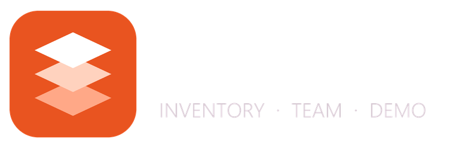
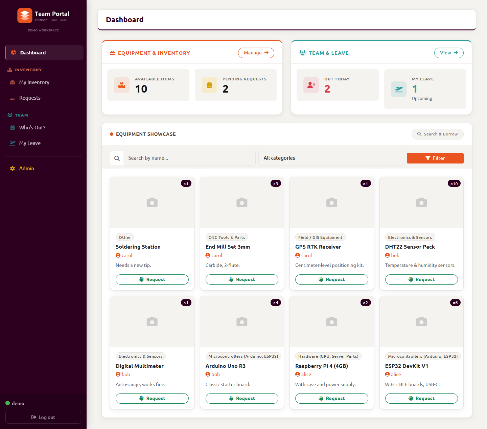
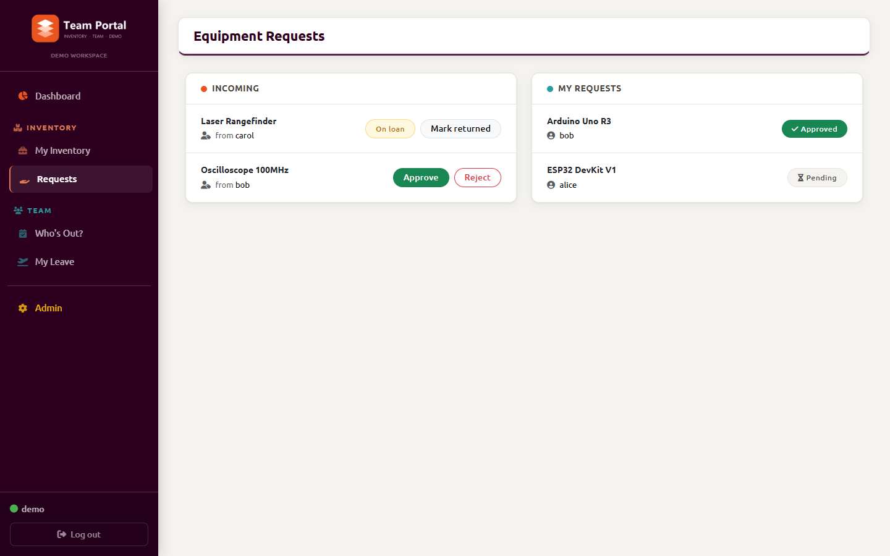
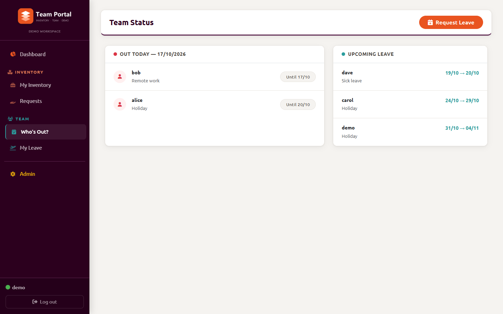
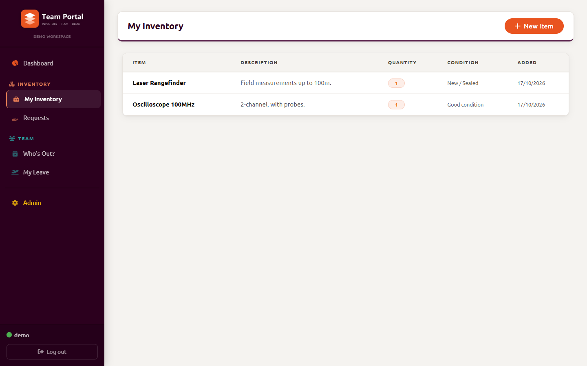
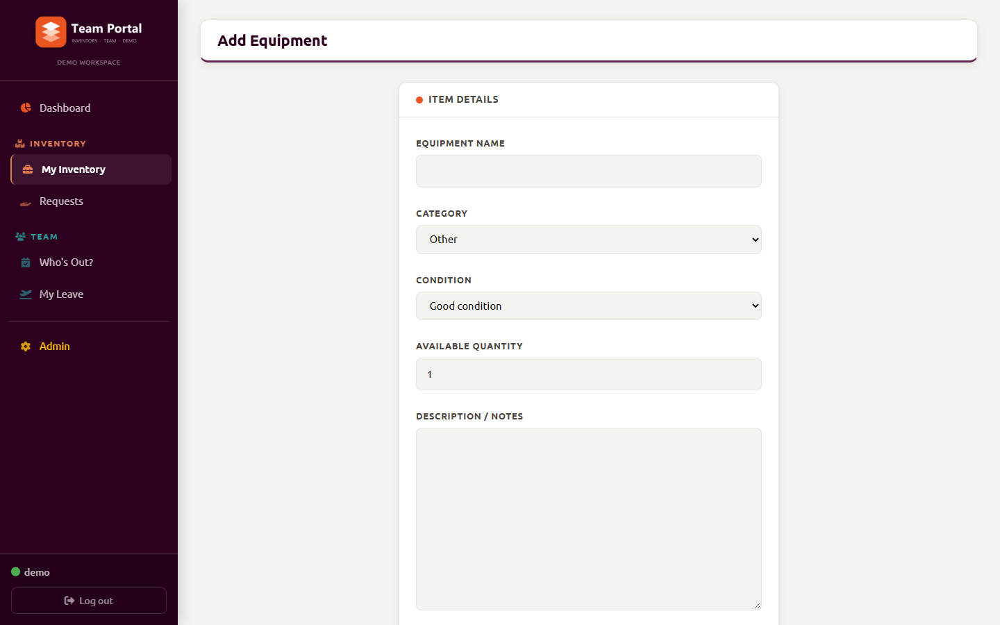
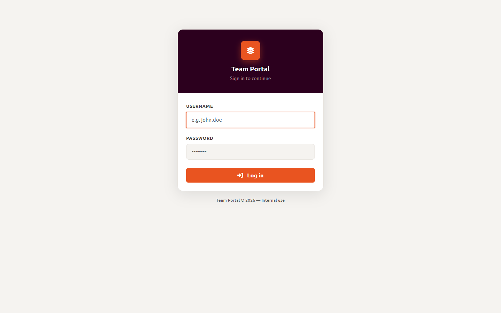

<p align="center">
  
</p>

<p align="center">
  <b>A lightweight Django portal for team equipment lending and absence tracking.</b><br>
  <a href="https://paypal.me/mixalhsxalk">
    
  </a>
</p>

---

**Team Portal** helps small teams, labs and workshops answer two everyday questions:

1. **Who has which piece of equipment, and can I borrow it?** (Inventory)
2. **Who is out of the office today or soon?** (Time off)

It is a simple, self-hosted alternative to heavyweight ERP tools. The UI uses Bootstrap 5 and an Ubuntu Yaru-inspired theme.



## Features

### Inventory
- **Showcase:** Browse every teammate's available equipment, with search and category filters.
- **Peer-to-peer lending:** Request an item straight from its owner.
- **Stock and condition tracking:** Track quantities (e.g. "×5") and condition (new, good, worn, needs repair).
- **Approve / reject / return:** The owner decides on each request, and stock updates automatically.

### Time off
- **Leave requests:** Request holiday or sick leave, or mark yourself as remote.
- **Team status:** See who is absent today and who has upcoming leave.
- **Admin approval:** Staff approve leave requests from the Django admin.

### Dashboard
- Live counters for available items, pending requests, people absent today and your upcoming leave.

## Screenshots

| Equipment requests | Team status |
|---|---|
|  |  |
| **My inventory** | **Add equipment** |
|  |  |

<p align="center"></p>

## Tech stack

- **Backend:** Python 3.10+, Django 5.2+
- **Database:** SQLite (zero setup)
- **Frontend:** Bootstrap 5, Font Awesome 6, vanilla JS

## Getting started

```bash
git clone https://github.com/mixalhsxalk/team-portal.git
cd team-portal

python -m venv venv
# Windows
venv\Scripts\activate
# Linux / macOS
source venv/bin/activate

pip install -r requirements.txt
python manage.py migrate
python manage.py seed_demo      # optional: demo users, items and leave
python manage.py runserver
```

Open <http://127.0.0.1:8000> in your browser.

### Demo accounts

`seed_demo` creates these accounts. All of them use the password **`demo1234`**:

| Username | Role |
|---|---|
| `demo` | Admin (can open `/admin/` to approve leave) |
| `alice`, `bob`, `carol`, `dave` | Regular teammates |

To use your own admin account instead, run `python manage.py createsuperuser`.

### Running tests

```bash
python manage.py test
```

## Configuration

The defaults are meant for local development. Before deploying, set these environment variables:

| Variable | Default | Purpose |
|---|---|---|
| `DJANGO_SECRET_KEY` | insecure demo key | **Must** be changed in production |
| `DJANGO_DEBUG` | `1` | Set to `0` in production |
| `DJANGO_ALLOWED_HOSTS` | `localhost,127.0.0.1` | Comma-separated host names |

## Project structure

```
core/        settings, root URLs, dashboard view
items/       inventory: items, borrow requests, seed_demo command
timeoff/     leave requests and team status
templates/   Django templates (Bootstrap 5)
static/      CSS, JS, logo
docs/        README screenshots
```

## Support

If you find this project useful, you can support its development:

[](https://paypal.me/mixalhsxalk)

**paypal.me/mixalhsxalk**
